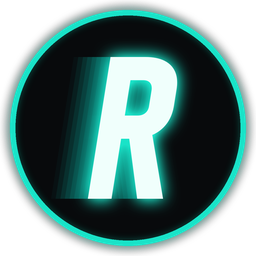
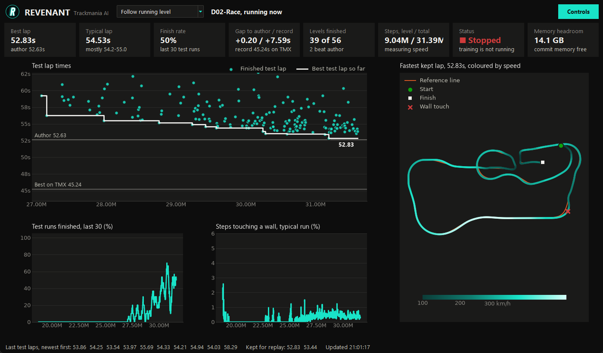
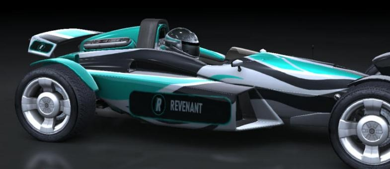
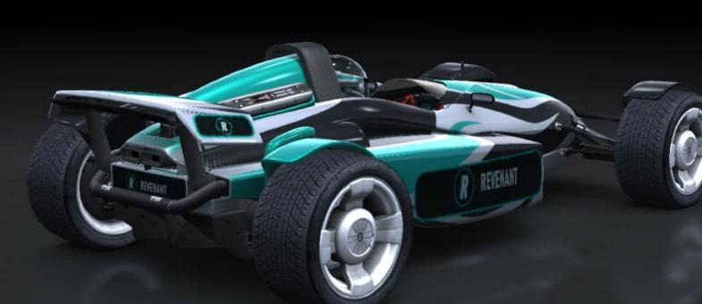
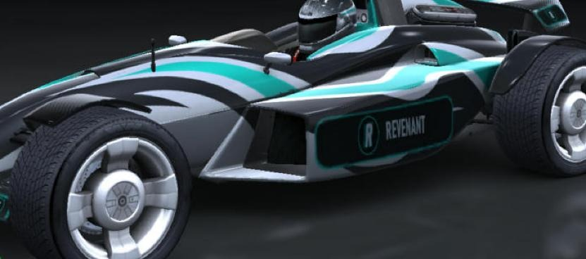
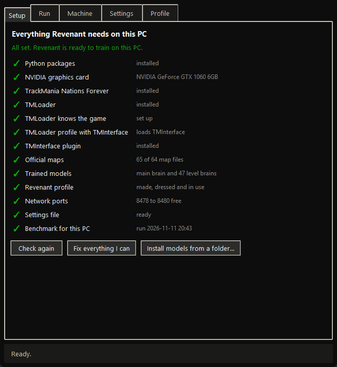
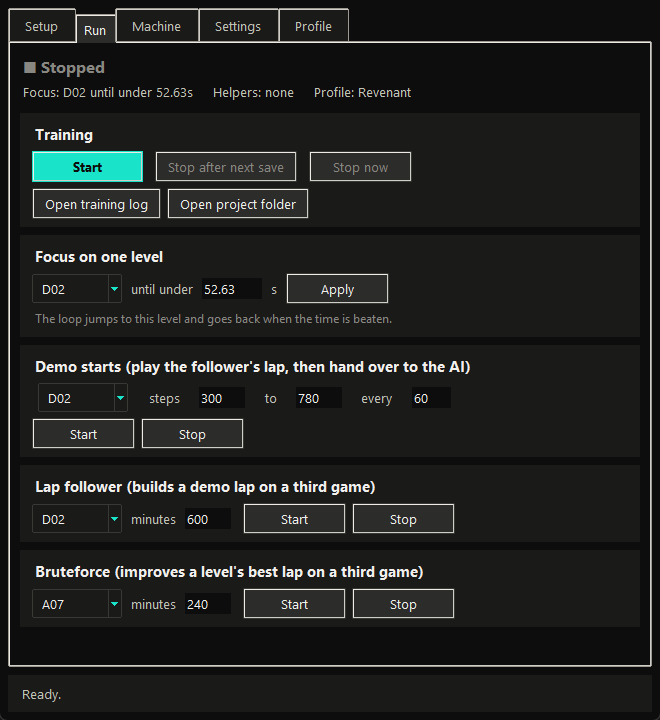
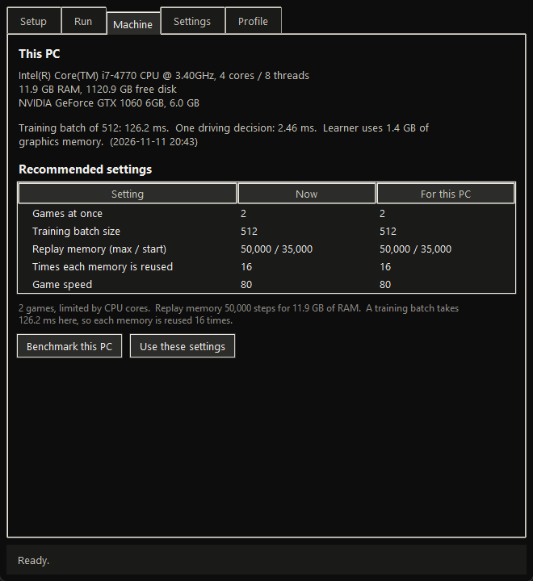
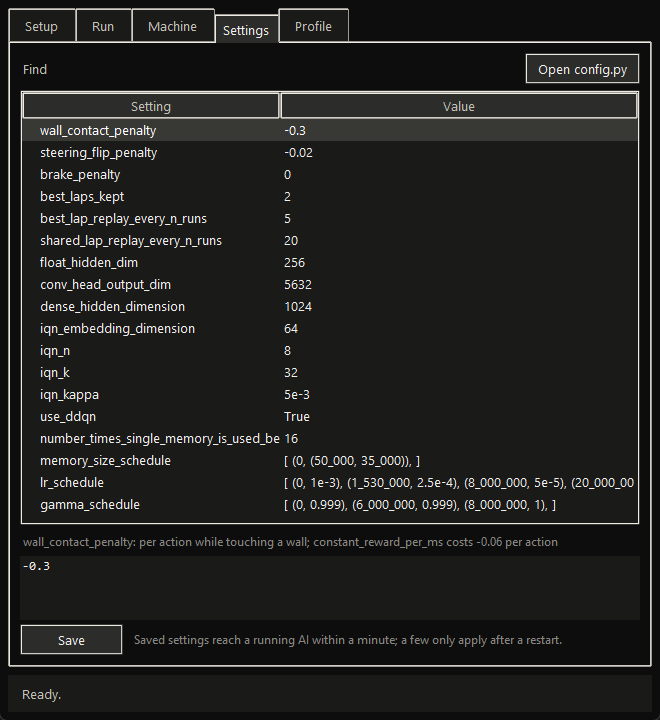
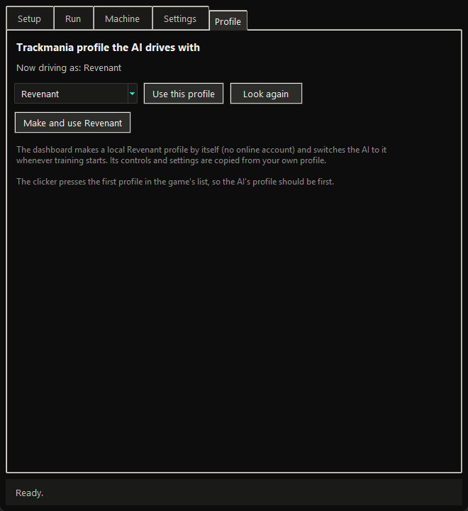

<p align="center">
  
</p>

<h1 align="center">Revenant</h1>

<p align="center">
  A self-taught AI for TrackMania Nations Forever.<br>
  It learns every official level by crashing a lot, then a bit less, then not at all.
</p>

<p align="center">
  
  
  
  
</p>

<p align="center">
  
</p>

> **Built with Claude Opus 5.5.** This whole project was made with Claude Opus 5.5 (Anthropic's AI model) doing the coding, debugging and testing while I steered it. Me and a friend wanted to see if it was possible to build a Trackmania AI that teaches itself to beat author times this way, so we tried it. It turns out it is.

## Contents

- [Results](#results)
- [Quick start](#quick-start)
- [Fresh or pretrained](#fresh-or-pretrained)
- [What it can do](#what-it-can-do)
- [The dashboard](#the-dashboard)
- [What you need](#what-you-need)
- [How it works](#how-it-works)
- [Project layout](#project-layout)
- [Credits](#credits)

## Results

After about 93 hours of training (31.6M steps) on an i7-4770 and a GTX 1060 6GB, Revenant has finished **40 of the 65 official levels** and beaten the **author time on 3** of them.

| Level | Time | | Level | Time | | Level | Time |
|---|---|---|---|---|---|---|---|
| A01 | 31.13 | | B05 | 33.15 | | C08 | 30.59 |
| A02 | 24.39 | | B06 | 35.24 | | C09 | 53.98 |
| A03 | 19.21 | | B07 | 48.51 | | C10 | 16.95 |
| A04 | 9.33 | | B08 | 2:29.28 | | C12 | 36.45 |
| A05 | 17.87 | | B09 | 16.20 | | C13 | 51.26 |
| **A07** | **26.52** 🏆 | | B10 | 41.94 | | **D01** | **2:33.24** 🏆 |
| A09 | 39.12 | | B11 | 34.68 | | D02 | 52.83 |
| A10 | 9.92 | | B12 | 1:06.34 | | **D03** | **15.90** 🏆 |
| A11 | 20.07 | | B13 | 28.99 | | D04 | 1:35.92 |
| A14 | 23.45 | | B14 | 38.14 | | D06 | 1:34.75 |
| A15 | 27.47 | | B15 | 1:00.72 | | D08 | 1:03.64 |
| B01 | 28.46 | | C01 | 31.92 | | | |
| B03 | 31.35 | | C03 | 14.17 | | | |
| B04 | 13.88 | | C06 | 1:04.71 | | | |
| | | | C07 | 44.56 | | | |

🏆 = author medal. It never plays online, so none of this touches the leaderboards.

<p align="center">
  
  
  
</p>

## Quick start

1. **Download** this repo. Out of the box it starts learning from nothing. If you want the trained Revenant instead, also grab the zips from the [Releases](../../releases) page and put them in a `models` folder (see [Fresh or pretrained](#fresh-or-pretrained)).
2. **Double-click `Revenant.bat`.** The first time it installs Python 3.11 if you need it and sets up the AI's libraries (about 3 GB).
3. **Follow the Setup tab.** It checks everything Revenant needs and puts a button next to anything missing. *Fix everything I can* does the ones that don't need you.

Then press **Start** on the Run tab. That's it. After the first time, it's just `Revenant.bat`.

### Fresh or pretrained

The repo itself has no trained data in it, so a fresh copy is a fresh start: it learns every level from scratch, the same way Revenant did. That takes days of training before it's finishing levels.

Everything Revenant has learned is on the [Releases](../../releases) page instead:

| File | What's in it |
|---|---|
| `revenant_core.zip` | the main brain and its training progress |
| `revenant_levels_A.zip` to `revenant_levels_D.zip` | one brain per level it's trained on |
| `revenant_laps.zip` | the D02 demo lap for demo starts and the bruteforced A07 lap |

Put them in a `models` folder next to `Revenant.bat` and press **Install** next to *Trained models* on the Setup tab (or use *Install models from a folder*). It carries on from exactly where Revenant is.

## What it can do

**Learning**
- Works through every official level in order, aiming for the author time on each. Every level keeps its own brain, so coming back to a level carries on from where it stopped.
- Moves on when it beats author, stops improving, or runs out of steps. You can also make it focus on one level until it beats a time you choose.
- Rewards tuned for Trackmania: a penalty for touching walls, a small speedslide reward, and checkpoint gates that only open when the game really counts the checkpoint.
- Replays its own best laps every few runs, and laps from other levels now and then, so it doesn't forget how it got fast.

**Getting unstuck**
- **Lap follower**: on levels it can't finish, a spare game builds a lap out of the AI's own controls by following the record line. Every step is checked against a straight replay, so the lap plays back exactly the same in training.
- **Demo starts**: play that lap up to a random point, then hand the car to the AI. This is how it got through D02's hairpin after five hours stuck at the same spot. It finished the level minutes later.
- **Bruteforce**: random search over a finished lap's inputs to shave off a bit more time.

**Running it**
- A dashboard with live lap times, finish rate, wall touches and the fastest lap drawn on the map, coloured by speed.
- Everything is controllable from it: start/stop (it waits for a save so nothing's lost), focus, demo starts, the follower, bruteforce, every training setting, and the game profile.
- Benchmarks your PC and picks settings that suit it.
- Plays as its own **Revenant** profile, with its own logo and car, made automatically. No online account.
- Gets new game windows past the profile screen by itself, so long runs carry on without you.
- Turns any lap into a video and a TMInterface `.inputs` file.

## The dashboard

Open it with `Revenant.bat`. The main window follows whatever level is training, or pick one from the list. **Controls** opens everything else:

| | |
|---|---|
|  | **Setup** checks the game, TMLoader, the TMInterface plugin, the official maps, the trained models, the Revenant profile, network ports and the benchmark. Anything missing gets a button. |
|  | **Run** starts and stops training, sets a focus level, and runs demo starts, the lap follower and bruteforce. |
|  | **Machine** shows your CPU, RAM and graphics card, times a real training batch and a driving decision on your GPU, and recommends how many games to run, the batch size, replay memory, memory reuse and game speed. One button applies them. |
|  | **Settings** has every training value, searchable, with notes. Changes reach a running AI within about a minute. It won't let you shrink the memory while training runs, because that crashes it. |
|  | **Profile** picks which Trackmania profile the AI drives with, and can make and dress the Revenant profile. |

## What you need

| | Minimum | What I used |
|---|---|---|
| OS | Windows 10 or 11 | Windows 11 |
| GPU | NVIDIA with 4 GB, GTX 10 series or newer | GTX 1060 6GB |
| CPU | 4 threads | i7-4770 (4 cores, 8 threads) |
| RAM | 8 GB | 12 GB |
| Disk | 10 GB free | |
| Game | TrackMania Nations Forever (free on Steam) | |
| Mod loader | TMLoader with TMInterface 2 (the Setup tab helps) | |

RTX 50 series cards need a newer PyTorch than the one the AI is pinned to, so they won't work yet. AMD and Intel graphics can't run it (it needs CUDA).

TMLoader injects into the game, so some antivirus programs flag it. That's a false positive; add its folder as an exception if yours complains.

## How it works

Revenant is built on [Linesight](https://github.com/Linesight-RL/linesight), an IQN reinforcement learning agent that talks to the game through TMInterface. Every 50 ms it gets a small greyscale picture of the screen plus the car's speed, angle, wheel contacts and the next stretch of the racing line, and picks one of 12 key combinations. It's rewarded for getting further along the line in less time.

[docs/HOW_IT_WORKS.md](docs/HOW_IT_WORKS.md) goes through the whole thing: the level loop, the rewards, demo starts, why the lap follower has to replay from the start, and what each setting does. If something goes wrong, [docs/TROUBLESHOOTING.md](docs/TROUBLESHOOTING.md) has the fixes for everything I ran into.

## Project layout

```
Revenant.bat                                   start here
dashboard.py                                   the main window
control_window.py, controls.py                 the Controls window and what it does
checks.py, machine.py, paths.py                setup checks, benchmark, finding folders on any PC
follow_line.py, refeed.py                      lap follower and demo starts
bruteforce.py, render_lap.py                   lap improver, video and inputs export
make_art.py, art/                              logo, car skin, profile template
linesight/                                     the AI itself (Linesight with my changes)
linesight/config_files/config.py               every training setting
linesight/maps/                                the racing line for each level
reference_replays/                             TMX record replays the follower uses
tmi/                                           TMInterface plugin and settings
docs/                                          how it works, troubleshooting, screenshots
```

## Credits

- **Unnamed477** for providing his own runs of levels to properly train the AI and find better lines per level. A lot of the lines Revenant learned from started with him.
- **Linesight** by the Linesight team ([docs](https://linesight-rl.github.io/linesight/build/html/)), which Revenant is a fork of.
- **TMInterface** by donadigo, and **TMLoader** by Tomashu.
- Record replays from [TMX](https://tmnf.exchange).
- Built with **Claude Opus 5.5**, see the note at the top.

MIT licence, see [LICENSE](LICENSE).
