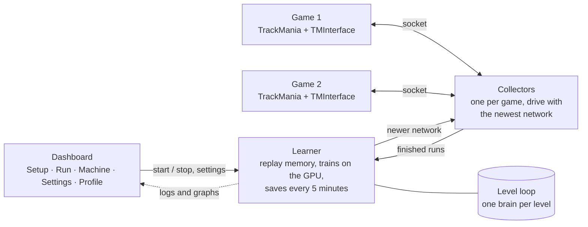

# How Revenant works

This goes through what happens when you press Start, from the game up to the level loop. Setting names in `code` are in `linesight/config_files/config.py` and can all be changed from the dashboard's Settings tab.

## The pieces

- **Games.** Each copy of the game runs through TMLoader with TMInterface, which lets Python pause the game, read the car's state, grab a frame and press keys.
- **Collectors.** One per game (`gpu_collectors_count`). They drive using the newest copy of the network and send each finished run to the learner.
- **Learner.** Keeps the recent runs in a replay memory (`memory_size_schedule`) and trains on random batches of them (`batch_size`) on the GPU.
- **Dashboard.** Reads the training log and TensorBoard files for the graphs (in a background process, so the window never freezes), and starts, stops and configures everything else.

## What the AI sees and does

Every 50 ms of game time (`tm_engine_step_per_action` = 5 physics steps) the game pauses and the AI gets:

- a 160×120 greyscale picture of the screen
- the car's speed, rotation and angular speed
- for each wheel: whether it's touching the ground, sliding, and what surface it's on
- the gear and engine RPM
- its last 5 actions (`n_prev_actions_in_inputs`)
- the next 400 m of the racing line as 40 points, 10 m apart, relative to the car (`n_zone_centers_in_inputs`)

It picks one of 12 actions: every combination of accelerate, brake, left and right that makes sense. The first second of every run is forced to full throttle (`forced_forward_actions`).

## The network

It's an IQN (Implicit Quantile Network). Instead of guessing one number for how good each action is, it guesses a spread of possible outcomes, which helps a lot in a game where tiny differences can mean a crash. A small convolutional network reads the picture, a dense one reads the numbers, and they're joined before the action values.

- Double DQN (`use_ddqn`) picks the next action with the online network and scores it with the target network, which stops it getting overconfident.
- It learns from 3 steps ahead at a time (`n_steps`).
- The discount (`gamma_schedule`) goes from 0.999 up to 1, so late in training it cares about the whole lap equally.
- Exploration (`epsilon_schedule`) starts fully random and drops to a few percent.

## Rewards

The AI's score for a run is built from:

| | Setting | Value |
|---|---|---|
| Every metre further along the line | `reward_per_m_advanced_along_centerline` | +0.01 |
| Every 50 ms that passes | `constant_reward_per_ms` | -0.06 |
| Every 50 ms touching a wall | `wall_contact_penalty` | -0.3 |
| Flipping steering from left to right | `steering_flip_penalty` | -0.02 |
| Speedsliding well | `engineered_speedslide_reward_schedule` | +0.01 |
| Passing a real checkpoint | `real_checkpoint_bonus` | +3 |

So the fastest way to get the most reward is to finish as quickly as possible without scraping walls.

**Checkpoint gates.** Progress along the line can't go past a checkpoint until the game itself counts that checkpoint. Without this, the AI found it could cut corners past checkpoints and get rewarded for a lap that would never finish. A ring checkpoint on A01 taught us this. For the last 60 m before each gate (`checkpoint_approach_zones`), drifting more than 3 m off the line costs a little, so it learns to line up for rings.

**Cutting runs short.** A run ends if it doesn't make progress for 2 seconds (`cutoff_rollout_if_no_vcp_passed_within_duration_ms`), so time isn't wasted on a car stuck against a wall.

## The level loop

Revenant trains on one level at a time and works through them in order (`linesight/config_files/all_maps.py`). Its goal on each one is the **author time** (`goal_times`).

56 of the 65 official levels are in the loop. `max_gold_s` (120) leaves out the 8 whose Gold time is over two minutes (C05, C14, D01, D14, D15, E02, E03 and E05), because long levels take far more steps per lap. E04 isn't in `all_maps.py` at all, because its record replay respawns and jumps 167 m, so it has no usable racing line. Raise `max_gold_s` to bring the long levels back in.

It stays on a level until:

1. it has finished it at least 10 times this visit (`min_finishes_per_level`), and
2. it has had its step budget: 150k steps (`steps_per_level`), or 50k if it already has author (`steps_per_level_with_gold`), and then
3. it either has the author time, or hasn't improved for 100k steps (`steps_without_improvement`).

`max_steps_per_level` (600k) stops a level it can't finish from holding everything up. It'll come back to it next time round.

Every level has its own brain in `linesight/save/all_levels_run1/levels/<level>`. When it moves on, it saves the current level's brain and loads the next level's, or starts from the last one if the next level is new. It remembers which level the brain in memory belongs to (`brain_level` in the stats) and only ever saves it as that level's brain, keeping the previous one as `weights1.torch.bak`. If the main brain on startup belongs to a different level than the one it's on (for example straight after installing the pretrained models), it loads that level's own brain instead.

**Focus.** `focus_level` and `focus_target_s` (or the Focus box on the Run tab) jump to one level and stay there until it beats that time, then go back to where the loop was. The target has to be under the level's current best, or the focus ends at once. Long levels are only in the level list while they're the focus, so the loop keeps track of levels by name rather than by their place in the list.

**Remembering what worked.** Every 5 runs (`best_lap_replay_every_n_runs`) it replays one of its own best laps on the current level, and every 20 (`shared_lap_replay_every_n_runs`) one from another level. That keeps good driving in the replay memory so it doesn't drift away from it.

## Getting unstuck: the lap follower and demo starts

Some levels have a part the AI just can't get through by trying random things. D02's hairpin stopped every single run for five hours. Two tools deal with that.

**The lap follower** (`follow_line.py`, Run tab) uses a third game to build a lap out of the AI's own 12 actions by following the level's record line:

1. At every 50 ms step it tries all 12 actions for a short look-ahead and keeps the one that stays closest to the line while going furthest along it.
2. It's penalised for going much faster or slower than the record replay at that point, and for wheels on grass.
3. If the car goes off or stalls, it backs up and tries again with some randomness, backing up further each time it fails in the same place.

The important bit is that **every step is committed by replaying the lap from the start**. Rewinding the game is exact once, but chains of rewinds drift by a centimetre or two, and on a jump that's the difference between landing and falling off. Training always plays laps from the start, so the follower does too, and the lap it saves plays back identically.

If it finishes, the whole lap goes to `bruteforce/<level>_follow_<ms>.npy` and is fed to training once. If it runs out of time first, it still keeps every checked step it has so far in `bruteforce/<level>_follow_partial.npy`, which is all demo starts need.

**Demo starts** (`refeed.py`, Run tab) take the follower's lap, play it up to a random step, then hand the car to the AI. The AI gets to practise the hard part from a good approach instead of failing before it. This is the "start from a demonstration" idea that was used to beat Montezuma's Revenge. On D02 it finished the level by itself within minutes of turning them on.

## Bruteforce

`bruteforce.py` (Run tab) takes a finished best lap and randomly changes a few of its inputs at a time on a spare game, keeping any change that finishes faster. Improvements are fed back into training. It took A07 from 26.52 to 26.51.

## Benchmarking and settings for your PC

The Machine tab:

1. reads your CPU, RAM, disk and graphics card
2. times 30 real training batches and 100 single decisions of the AI's network on your GPU
3. works out:
   - games at once from CPU threads, RAM and graphics memory
   - batch size from graphics memory
   - replay memory from RAM left over after the games
   - how often each memory is reused from how fast your GPU trains
   - game speed from CPU threads

The rules were calibrated on the PC Revenant was trained on, where they give exactly the settings it trained with.

## The profile and car

The dashboard makes a local `Revenant` profile (no online account) by copying the settings of an existing profile, or a built-in template, and changing its name and ID. It installs the logo as its avatar and the Revenant car skin, and writes the skin's checksum into the profile so the game accepts it straight away. `make_art.py` draws both: the car is a recoloured stock car with every sticker replaced and turned to match how the game maps it.

## Files it writes

| Where | What |
|---|---|
| `linesight/save/all_levels_run1/` | the brains, replay of best laps, training state |
| `linesight/tensorboard/` | the numbers behind the graphs |
| `logs/` | training log, clicker log, follower and bruteforce logs |
| `bruteforce/` | follower laps, bruteforced laps, the demo start queue |
| `machine.json` | your PC's benchmark |
| Documents\TrackMania\Profiles | the Revenant profile |
| Documents\TrackMania\Skins | the Revenant car and logo |
| Documents\TMInterface\Plugins | the plugin that lets Python talk to the game |
